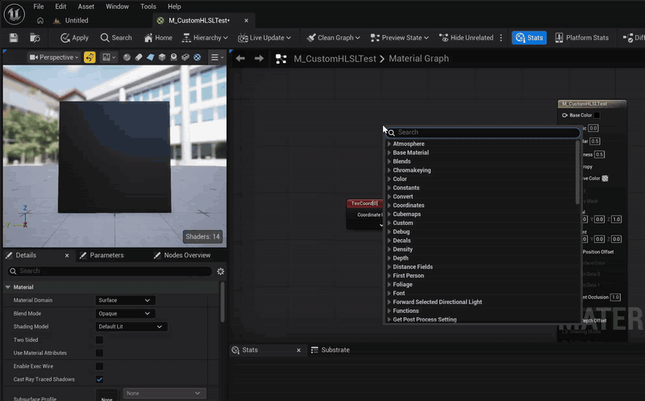

# Custom HLSL Tools

English | [日本語](README_ja.md)

An editor-only plugin for editing the HLSL used by Material **Custom nodes** in an external editor (VS Code / Rider / Visual Studio, etc.).



## Features

- **Open Include Files in External Editor** button
  Added to the Custom node's Details panel. Opens the `.ush` / `.usf` files listed in `Include File Paths` in your external editor.
- **Auto-recompile on save**
  Watches `<Project>/Shaders` and the `Shaders` folders of enabled non-Engine plugins. When a `.ush` / `.usf` file is saved, loaded materials that include files from that folder are recompiled.
- **Settings** (`Editor Preferences > Plugins > Custom HLSL Tools`)
  How to launch the external editor (Source Code Accessor / OS file association / custom command), auto-recompile ON/OFF, and the delay before recompiling.
  If you choose `Source Code Accessor`, the editor selected in `Editor Preferences > General > Source Code` is used.

## Usage

1. Create `<Project>/Shaders/MyFunc.ush` and define a function.
   ```hlsl
    float3 MyFunc(float3 A, float B)
    {
        return A * B;
    }
   ```
2. Restart the editor. The `/Project` virtual path is registered only if `<Project>/Shaders` exists at startup.
3. Add `/Project/MyFunc.ush` to the Custom node's `Include File Paths`, and write `return MyFunc(A, B);` in `Code`.
4. Click **Open Include Files in External Editor** in Details, edit the file, and save.

## Installation

Place this repository at `<Project>/Plugins/CustomHLSLTools`.

## How it works / Limitations

- The content hash of include files is part of the material's shader map ID, so recompiling after `FlushShaderFileCache()` picks up the changes.
- Virtual paths are resolved with `GetShaderSourceFilePath()`, so only the `.ush` / `.usf` extensions are valid.
- A material is recompiled if it includes a file under a watched folder where a change occurred. Changes to files that are further included from a `.ush` are also detected, but a change to a different file in the same folder may also trigger a recompile.
- Material instances are updated when their parent material is recompiled.

## Supported versions

Developed against source-built UE 5.8. The plugin depends on engine-internal APIs (`MaterialEditingLibrary`, `FMaterialCachedExpressionData`, etc.), so other versions may require build fixes.

## License

The code of this plugin is provided under the [MIT License](LICENSE).

Unreal Engine itself is governed by Epic Games' [Unreal Engine EULA](https://www.unrealengine.com/eula).

## Support

Please report bugs and requests via [GitHub Issues](https://github.com/kugimasa/CustomHLSLTools/issues).
