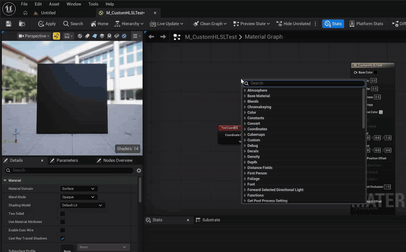

# Custom HLSL Tools

[English](README.md) | 日本語

マテリアルの **Custom ノード**で使う HLSL を、外部エディタ(VS Code / Rider / Visual Studio など)で編集するためのエディタ専用プラグインです。



## 機能

- **Open Include Files in External Editor** ボタン
Custom ノードの Details に追加されます。`Include File Paths` に登録された `.ush` / `.usf` を外部エディタで開きます。
- **保存時の自動再コンパイル**
`<Project>/Shaders` と(エンジン以外の)有効なプラグインの `Shaders` フォルダを監視し、`.ush` / `.usf` が保存されると、そのフォルダのファイルを include しているロード済みマテリアルを再コンパイルします。
- **設定** (`Editor Preferences > Plugins > Custom HLSL Tools`)
外部エディタの起動方法 (Source Code Accessor / OS 関連付け / 任意コマンド)、自動再コンパイルの ON/OFF、待ち時間。
`Source Code Accessor` を選んだ場合は `Editor Preferences > General > Source Code` で選択したエディタが使われます。

## 使い方

1. `<Project>/Shaders/MyFunc.ush` を作成し、関数を定義します。
   ```hlsl
    float3 MyFunc(float3 A, float B)
    {
        return A * B;
    }
   ```
2. エディタを(再)起動します。`/Project` の仮想パスは、起動時に `<Project>/Shaders` が存在する場合のみ登録されます。
3. Custom ノードの `Include File Paths` に `/Project/MyFunc.ush` を追加し、`Code` に `return MyFunc(A, B);` と書きます。
4. Details の **Open Include Files in External Editor** を押して編集し、保存します。

## インストール

このリポジトリを `<Project>/Plugins/CustomHLSLTools` に配置します。

## 仕組み・制約

- include ファイルの内容ハッシュはマテリアルのシェーダーマップ ID に含まれるため、`FlushShaderFileCache()` 後に再コンパイルすれば変更が反映されます。
- 仮想パスの解決は `GetShaderSourceFilePath()` を使っており、拡張子は `.ush` / `.usf` のみ有効です。
- 再コンパイル対象の判定は「変更があった監視フォルダ配下のファイルを include しているか」です。`.ush` 内からさらに include されるファイルの変更も拾えますが、同じフォルダの別ファイルの変更でも再コンパイルされることがあります。
- マテリアルインスタンスは親マテリアルが再コンパイルされると更新されます。

## 対応バージョン

UE 5.8

## ライセンス

本プラグインのコードは [MIT License](LICENSE) で提供されます。

Unreal Engine 本体は、Epic Games の [Unreal Engine EULA](https://www.unrealengine.com/eula) に従います。

## サポート

不具合報告・要望は [GitHub Issues](https://github.com/kugimasa/CustomHLSLTools/issues) へお願いします。